# Windows IKEv2 VPN Client and Wireshark Packet Analysis

**Author:** Marcus Draper  
**Environment:** Academic virtual lab  
**Tools:** Windows VPN client, PowerShell, pfSense, Wireshark  
**Focus:** Client configuration, routing, troubleshooting, and comparison of cleartext and protected traffic.

## Overview

In this lab, I configured Windows VPN client profiles for a pfSense endpoint, added a route to the internal LAN, and tested reachability. I examined client status and compared FTP, SSH, ESP, and IKE traffic in Wireshark. The work includes troubleshooting PowerShell commands and reviewing IPsec settings returned by the configuration cmdlet.

The evidence shows a connected IKEv2 client and reachable internal host. It also illustrates why readable FTP credentials and file contents differ from SSH encrypted packets and ESP traffic. Packet inspection is documented separately from claims about completed file transfers or exact tunnel algorithms.

## Skills demonstrated

- Configuring a Windows IKEv2 VPN profile with EAP authentication.
- Creating a split-tunnel profile and an explicit LAN route using PowerShell.
- Testing reachability with `ping` and `tracert`.
- Inspecting client tunnel details and assigned addresses.
- Troubleshooting invalid parameters and unavailable PowerShell commands.
- Using Wireshark protocol filters and inspecting packet details and bytes.
- Distinguishing IKE negotiation, ESP traffic, and SSH application encryption.
- Redacting credentials before publishing evidence.

## Lab environment

| Component | Address / role shown |
| --- | --- |
| RemoteWindows01 | 10.0.1.2; remote VPN client |
| pfSense WAN | 202.20.1.1; endpoint in client properties and IKE traffic |
| pfSense LAN | 172.30.0.1 |
| vWorkstation | 172.30.0.2; internal connectivity target |
| LAN route | 172.30.0.0/24 |
| Assigned VPN client address | 172.31.1.1 in Windows status |
| Tested DMZ service host | 172.40.0.20 in later FTP/SSH captures |
| Sample capture endpoints | 172.30.0.2 and 172.30.0.100 |

The course topology labels TargetLinux01 as `172.40.0.2`, but the later FTP/SSH results show `172.40.0.20`. I preserve that discrepancy. The sample capture host `172.30.0.100` is a separate endpoint and is not assumed to be the DMZ service host.

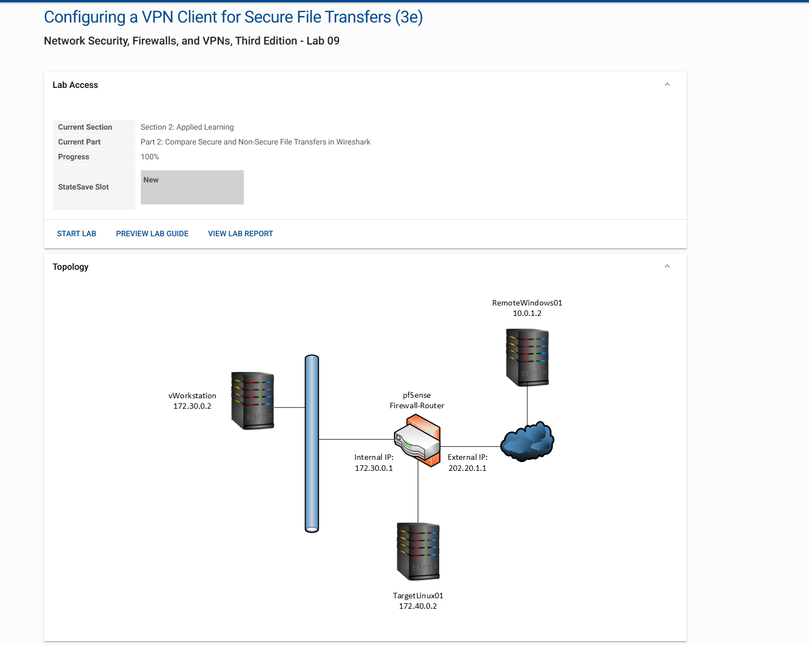

## 1. Configure and inspect the Windows client

The Windows profile points to `202.20.1.1` and uses username/password sign-in. Personal profile names and the authentication identifier are blocked out in the published screenshot.

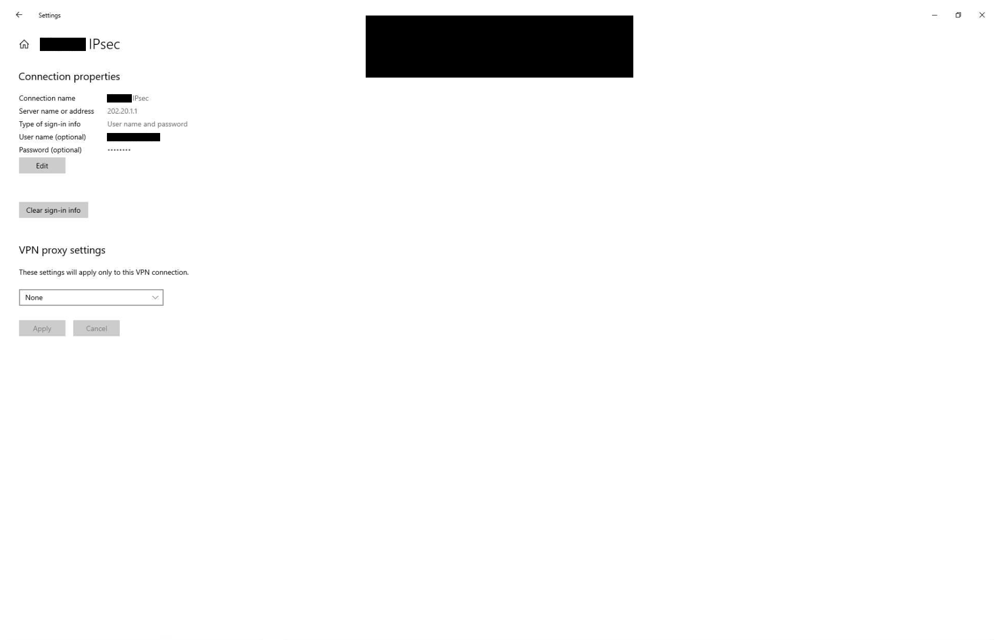

A later status dialog shows:

| Field | Reported value |
| --- | --- |
| Device | WAN Miniport (IKEv2) |
| Device type | vpn |
| Authentication | EAP |
| Encryption | IPsec: AES 256 |
| Client IPv4 address | 172.31.1.1 |
| Origin address | 10.0.1.2 |
| Destination address | 202.20.1.1 |

The dialog also displays Server IPv4 address as `0.0.0.0`; I do not treat that field as the endpoint address because the same view separately identifies the destination.

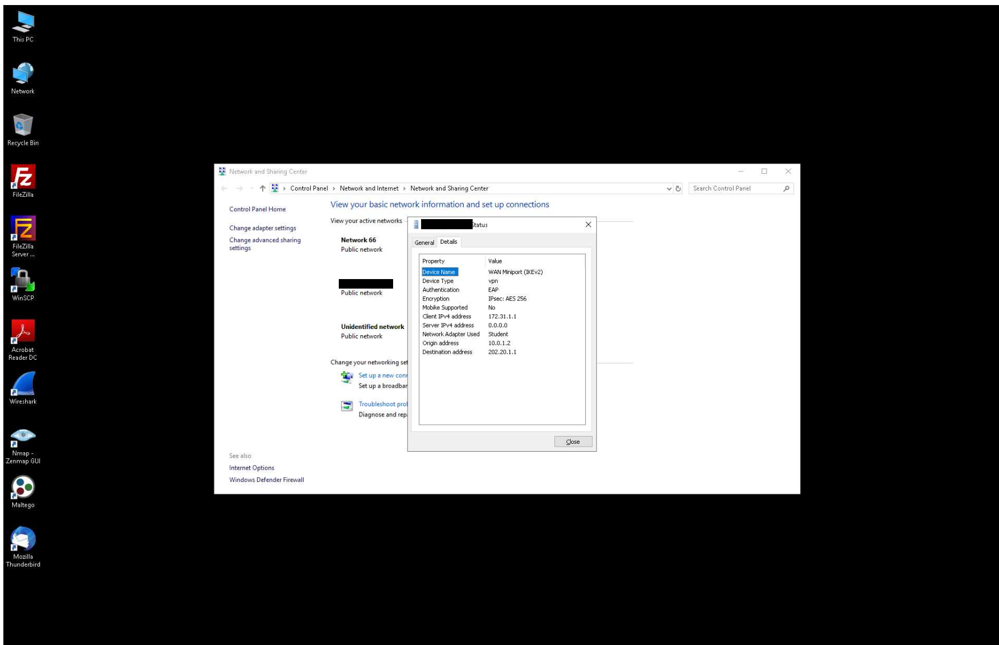

## 2. Create a profile and add a LAN route with PowerShell

The screenshots and written lab response record creation of a profile with IKEv2, required encryption, EAP, split tunneling, and an all-user scope. This example normalizes the personal profile name and uses the endpoint shown in the actual client properties and negotiation traffic:

```powershell
# Documentation example; normalized from the lab evidence.
Add-VpnConnection -Name "Lab-IKEv2" `
    -ServerAddress "202.20.1.1" `
    -TunnelType IKEv2 `
    -EncryptionLevel Required `
    -AuthenticationMethod EAP `
    -SplitTunneling `
    -AllUserConnection
```

The supplied written response instead lists `202.20.1.2`, while the visible client properties, connected-profile command, and IKE exchange use `202.20.1.1`. This example corrects that inconsistency explicitly; it is not a verbatim transcript or a script executed while preparing this repository.

The route output shows destination prefix `172.30.0.0/24`, IPv4 address family, and route metric 1. For an all-user profile, the following normalized example keeps the same profile scope:

```powershell
Add-VpnConnectionRoute -ConnectionName "Lab-IKEv2" `
    -DestinationPrefix "172.30.0.0/24" `
    -AllUserConnection `
    -PassThru
```

The screenshot's command does not visibly include the all-user flag for its route operation. The example above records a consistent intended scope; successful route output in the screenshot is reported separately.


## 3. Validate client reachability

The remote client successfully pings the internal workstation:

```powershell
ping 172.30.0.2
```

The result shows **4 packets sent, 4 received, 0% loss**.


Another screenshot shows the VPN as **Connected** and a `tracert 172.30.0.2` reaching the workstation at hop 2 after a timeout at hop 1. The timeout does not prevent the final target from responding. A separate earlier trace targets `202.20.1.2`; that result is not substituted for the LAN test.

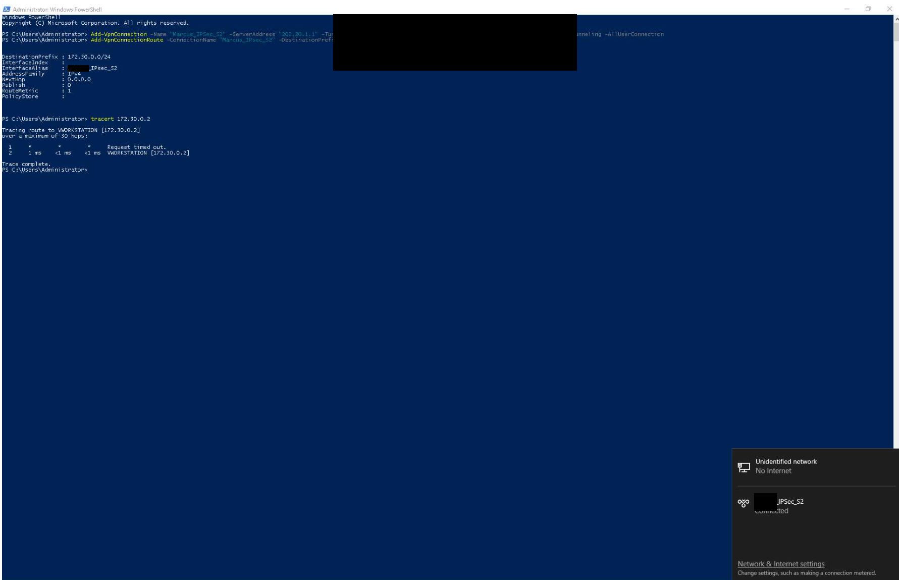

Together, client status and reachability provide stronger evidence than a configuration page alone. No complete client routing-table dump or tunnel packet counter is supplied, so these screenshots do not trace every application flow through the VPN.

## 4. Document PowerShell troubleshooting

The IPsec customization screenshot contains several failed attempts followed by returned configuration values:

| Observation | What the evidence shows |
| --- | --- |
| Invalid parameter | An attempted encryption parameter is rejected as unrecognized |
| Unrecognized command | An attempted `Get-VpnConnectionIPsecConfiguration` is not recognized in that environment |
| Incomplete invocation | Other Set cmdlet attempts produce parameter-set errors |
| Later invocation | A corrected Set cmdlet invocation prompts for required fields and returns configuration values |

The confirmed result is the final returned configuration table:

| Returned field | Value |
| --- | --- |
| AuthenticationTransformConstants | SHA256128 |
| CipherTransformConstants | AES256 |
| DHGroup | ECP256 |
| IntegrityCheckMethod | SHA256 |
| PfsGroup | ECP256 |
| EncryptionMethod | AES256 |

This is local configuration output, not proof that those exact choices were negotiated in the later IKE session. The IKE response screenshot shows DH group 14, which differs from the ECP256 value returned here. Additional client/server logs would be needed to reconcile the two.

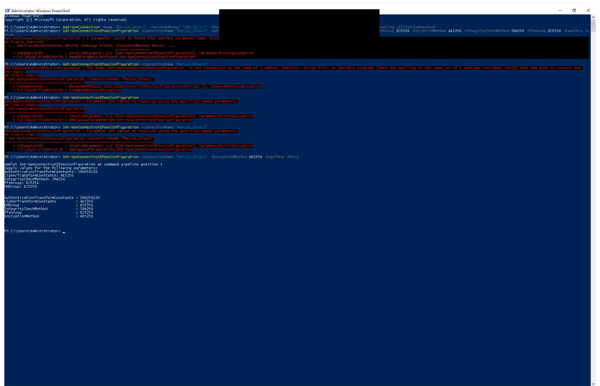

## 5. Compare traffic in Wireshark

### Cleartext FTP control traffic

The sample `ftp-capture.pcapng` view, filtered with `ftp`, shows recognizable USER/PASS commands, failed logins, a later successful login, and file retrieval commands. Password values have been blocked out in the published screenshot.

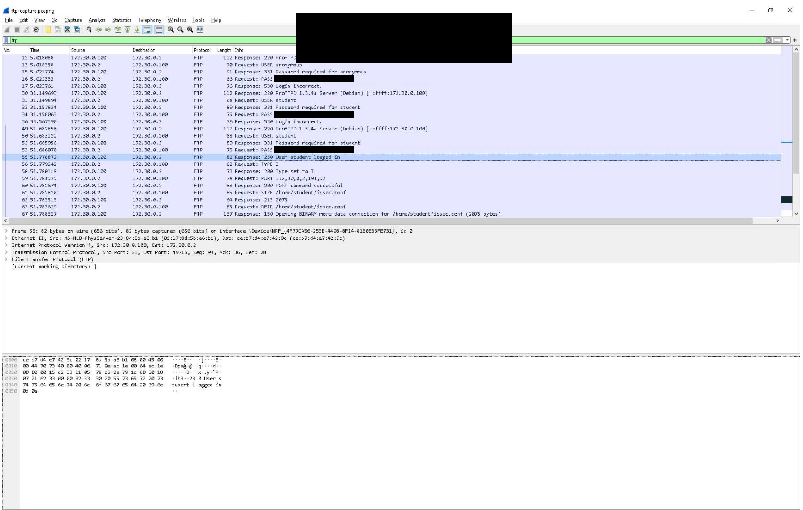

The `ftp-data` view displays readable configuration-file text in the packet bytes. This demonstrates application payload visibility in that capture, beyond just observing an FTP session.

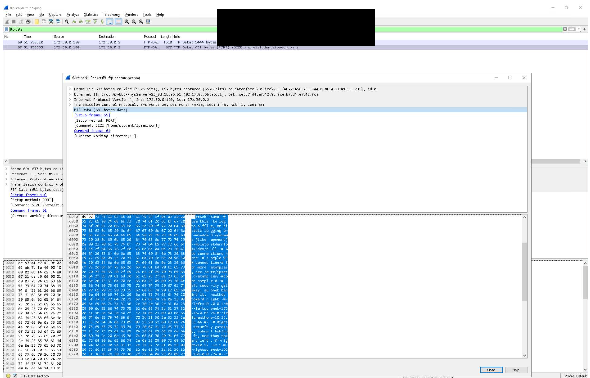

### ESP and SSH in the supplied sample capture

The `ipsec-capture.pcapng` overview includes ESP traffic along with other protocols. The expanded packet in the overview is NBNS, so it is not presented as ESP detail.

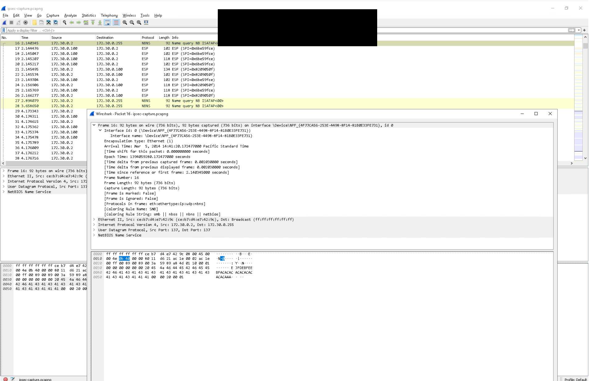

Filtering the sample capture with `esp` shows ESP packets and their security parameter indexes. Filtering it with `ssh` shows an SSH protocol banner. A readable SSH identification banner is not evidence that authenticated session contents or passwords are readable.

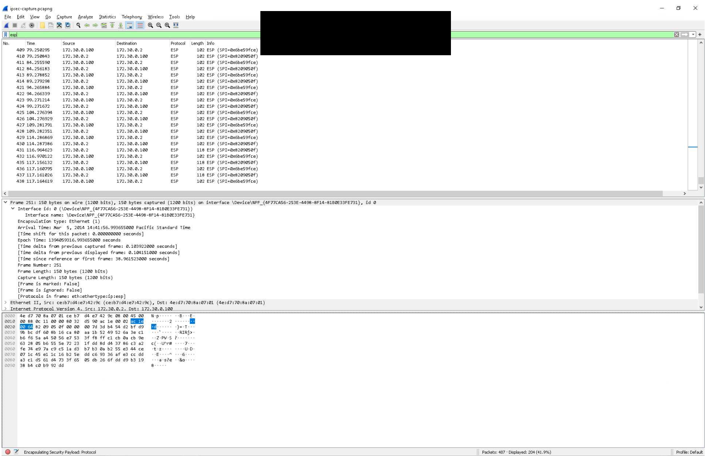

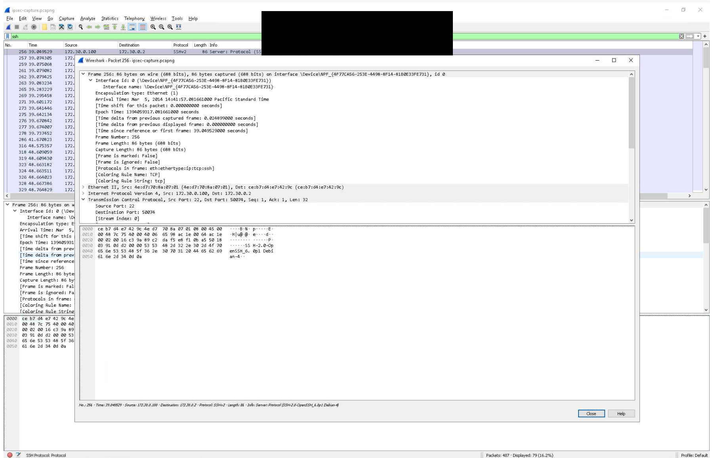

### Later lab FTP versus SSH traffic

The later local FTP capture involves `172.30.0.2` and `172.40.0.20`. It shows a successful login and RETR attempts; some receive **550 Failed to open file**. The visible final RETR does not have a completed-transfer response in the screenshot. I therefore do not claim that this evidence proves a completed download.

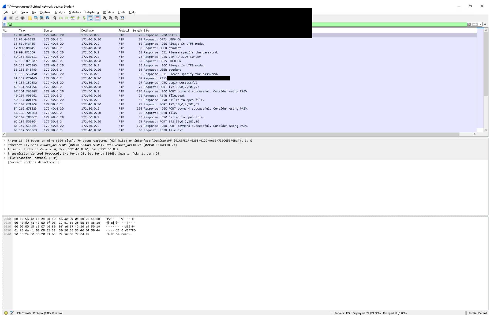

The SSH view between the same endpoints shows version banners, key exchange, new keys, and multiple rows labeled **Encrypted packet**. This supports an encrypted SSH session, but does not by itself establish the file-transfer subsystem or a completed SFTP transfer.

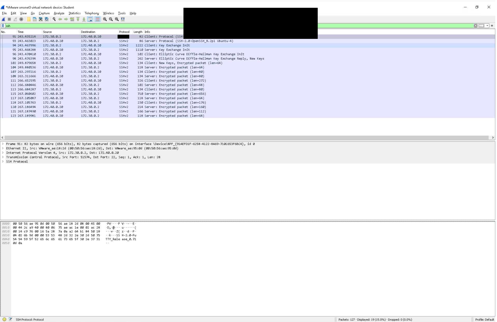

## 6. Inspect IKE negotiation

The remote-interface capture shows IKE_SA_INIT and IKE_AUTH requests/responses between `10.0.1.2` and `202.20.1.1`. The packet details show UDP source and destination port **500**.

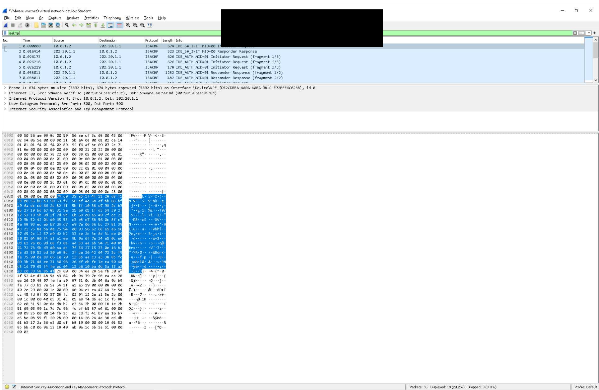

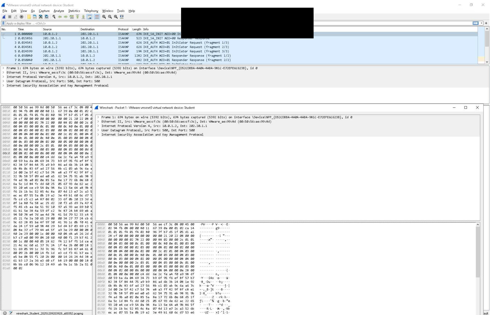

The expanded responder packet shows a key-length value of **256**, integrity transform **AUTH_HMAC_SHA2_256_128**, PRF **PRF_HMAC_SHA2_256**, and Diffie-Hellman **2048-bit MODP group 14**. The visible key-length line alone does not expose the encryption transform name; the separate Windows client dialog reports AES 256.

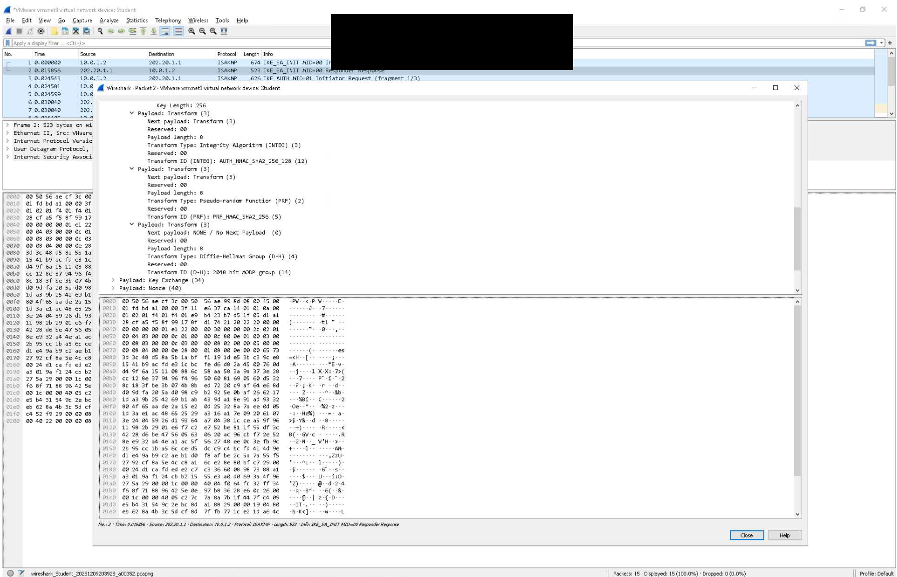

Two supplied captures show `ftp` entered in the filter box while the packet list still displays IKE traffic. They are omitted as redundant and are not treated as evidence that the FTP filter was applied or that FTP traffic was encrypted through the VPN.

## Comparison and findings

| Traffic | What is visible in the supplied evidence | What can be concluded |
| --- | --- | --- |
| FTP control | Login and file commands; password values visible before redaction | The capture exposes cleartext authentication data |
| FTP data | Readable configuration text | File contents can be inspected in that capture |
| SSH | Banners, key exchange, encrypted-packet rows | Session traffic is protected after key exchange; banners remain observable |
| ESP | Outer addresses, protocol, SPI, packet sizes | ESP traffic is present; the screenshot does not independently verify cipher settings |
| IKE | Negotiation types and selected response fields | VPN negotiation can be inspected without claiming readable application content |

## Evidence boundaries

- The sample packet-detail timestamps show March 5, 2014, while lab screenshot watermarks show December 9, 2025. The older sample captures are analyzed training material, not claimed as traffic I generated during the later lab.
- Screenshots are supplied, but the raw `.pcapng` files are not included.
- No transfer completion record or source/destination file hashes are supplied.
- IKE capture, connected-client evidence, and local FTP/SSH captures come from different views and stages. They do not establish that every shown file operation traversed the same VPN connection.
- Custom IPsec configuration output and observed IKE response use different DH group labels; the difference is documented, not explained by an assumed mapping.
- Course progress is 100%, but conclusions are limited to the visible technical evidence.

## Follow-up validation

- [ ] Record full client routes and server security associations.
- [ ] Reconcile endpoint/profile differences and cryptographic configuration with the negotiated session.
- [ ] Capture the same transfer on the client tunnel and external interface.
- [ ] Demonstrate completed SFTP upload/download and compare file hashes.
- [ ] Retain sanitized packet exports with capture-interface and filter notes.
- [ ] Verify permitted LAN services and blocked destinations.

## Lessons learned

The client screenshots connect VPN configuration to real reachability. Packet analysis adds another layer: cleartext FTP can reveal credentials and file contents, while SSH and ESP expose different levels of metadata. Configuration output, negotiated properties, and application results should be documented separately so the conclusions stay accurate.

## Files and attribution

All PNGs sit beside README.md. See [EVIDENCE.md](EVIDENCE.md) and [UPLOAD.md](UPLOAD.md). No credentials, private keys, executable deployment script, or raw packet capture is included.

Based on **Configuring a VPN Client for Secure File Transfers (3e)**, *Network Security, Firewalls, and VPNs, Third Edition — Lab 09*. This repository documents academic work and analysis of training captures, not the complete course guide. Third-party materials retain their respective ownership.
